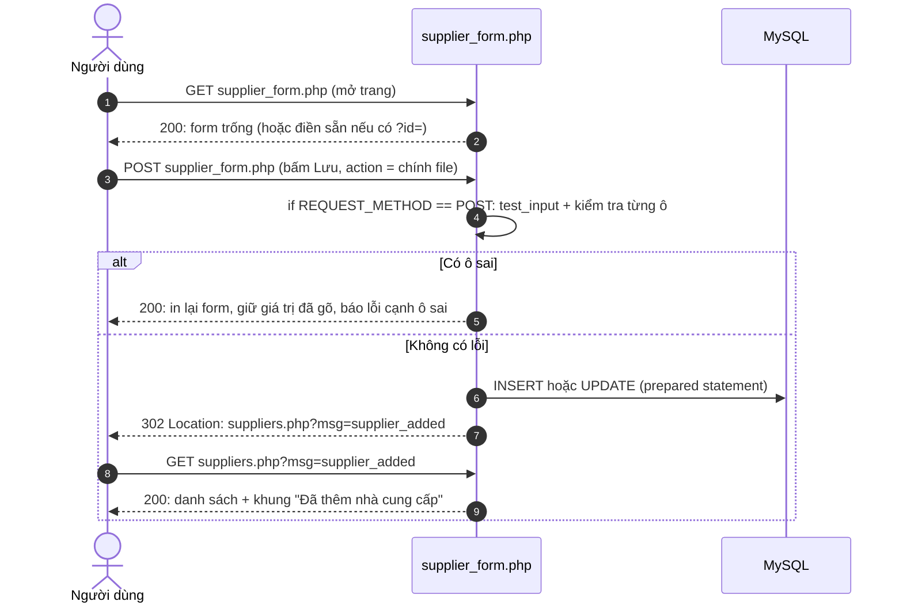

# 00. CẤU TRÚC DỰ ÁN VÀ MẪU FORM CHUẨN W3SCHOOLS

Đây là file quan trọng nhất: hiểu file này là hiểu cách MỌI trang trong dự án chạy.

---

## 1. TRẢ LỜI CÂU HỎI: "luồng PHP có phải đi từ form HTML → file PHP → phương thức → gửi lại form không?"

Gần đúng. Nói chính xác theo kiểu W3Schools thì như sau:

> **Một trang = một file `.php` chứa CẢ form HTML lẫn đoạn PHP xử lý form.**
> Form gửi dữ liệu về **chính file đó**. Mỗi lần file chạy, PHP hỏi: "lần này là GET hay POST?"

| Lần gọi | Phương thức | PHP làm gì | Kết quả |
|---|---|---|---|
| 1. Người dùng mở trang | **GET** | Bỏ qua khối xử lý, chỉ in form (trống hoặc điền sẵn từ database) | Form hiện ra |
| 2. Người dùng bấm **Lưu** | **POST** (về chính file) | Lấy dữ liệu → kiểm tra từng ô | Rẽ làm 2 nhánh ↓ |
| 2a. Có ô sai | (vẫn là lần POST đó) | Ghi câu báo lỗi vào biến `$xxxErr`, **in lại form** kèm lỗi và giá trị đã gõ | Form hiện lại, báo lỗi cạnh ô sai |
| 2b. Tất cả đúng | (vẫn là lần POST đó) | `INSERT/UPDATE` vào database, rồi `header("Location: ...")` | Trình duyệt chuyển (GET) sang trang danh sách kèm thông báo |

Vậy chuỗi bạn nói thành: **form HTML → (POST) → chính file PHP → khối `if POST` kiểm tra + xử lý → hoặc in lại form (có lỗi), hoặc chuyển sang danh sách (thành công)**.

"Phương thức" ở đây có hai nghĩa, đều đúng:
* `method="post"` trong thẻ `<form>` (cách trình duyệt gửi dữ liệu);
* `$_SERVER["REQUEST_METHOD"]` trong PHP (cách PHP biết lần này là GET hay POST).



---

## 2. CẤU TRÚC THƯ MỤC (phẳng, không có thư mục con cho code)

```
Bai3/
├── config.php          ← cấu hình + nối DB + mở session + nạp functions.php   (MỌI trang bắt đầu bằng require_once "config.php")
├── connect.php         ← tạo biến $conn (PDO MySQL)
├── functions.php       ← các hàm dùng chung: test_input, h, getAll/getOne/execute, kiểm tra định dạng, phân trang, upload...
├── xlsx.php            ← tạo file Excel (chỉ supplier_export.php dùng)
│
├── head.php, header.php, footer.php            ← khung trang quản trị (menu bên trái)
├── header_public.php, footer_public.php        ← khung trang công khai cho khách
├── header_auth.php, footer_auth.php            ← khung trang đăng nhập
│
├── login.php  logout.php  change_password.php  ← đăng nhập / đăng xuất / đổi mật khẩu
├── index.php  detail.php                       ← KHÁCH: trang chủ + chi tiết (không cần đăng nhập)
├── dashboard.php                               ← tổng quan (admin)
│
├── suppliers.php  supplier_form.php  supplier_detail.php  supplier_delete.php  supplier_export.php
├── contact_form.php  contact_delete.php  contact_primary.php
├── transactions.php  transaction_form.php  transaction_pay.php  transaction_delete.php  transaction_invoice.php
├── evaluations.php  evaluation_form.php  evaluation_delete.php
├── categories.php  category_form.php  category_delete.php
├── users.php  user_form.php  user_delete.php
│
├── assets/             ← css, js, favicon
├── uploads/            ← logos/, invoices/ (file người dùng tải lên)
└── database/           ← schema.sql, seed.sql
```

**Quy ước đặt tên** (nhìn tên file là biết vai trò):

| Tên file | Vai trò | Có giao diện? |
|---|---|---|
| `xxx.php` (số nhiều: `suppliers.php`) | **Danh sách** | Có |
| `xxx_form.php` | **Form thêm + sửa** (một file cho cả hai) | Có |
| `xxx_detail.php` | Trang xem chi tiết | Có |
| `xxx_delete.php`, `xxx_pay.php`, `xxx_primary.php` | **Chỉ xử lý POST** rồi chuyển trang | Không |

Địa chỉ trình duyệt gõ chính là tên file: `http://localhost/Bai3/suppliers.php`.

---

## 3. KHUNG XƯƠNG CỦA MỘT FILE FORM (4 bước)

Mọi file `xxx_form.php` đều có đúng 4 đoạn, đánh số ngay trong code. Lấy `supplier_form.php` làm mẫu:

| Bước | Dòng | Nội dung |
|---|---|---|
| Mở đầu | 11–12 | `require_once "config.php"; requireLogin();` – nạp cấu hình, chưa đăng nhập thì chuyển về `login.php` |
| **1. Khai báo biến** | 14–29 | `$code = $name = ... = "";` và `$codeErr = $nameErr = ... = "";` (ban đầu đều rỗng). Có `?id=` thì đọc dòng cũ từ DB |
| **2. Khi POST: lấy + kiểm tra** | 31–94 | `if ($_SERVER["REQUEST_METHOD"] == "POST") {` → `test_input($_POST[...])` → từng ô kiểm tra, sai thì gán câu vào `$xxxErr` |
| **3. Không lỗi: ghi DB** | 96–152 | `if ($codeErr == "" && $nameErr == "" ...)` → `INSERT/UPDATE` → `header("Location: ...")` + `exit` |
| (GET sửa) điền sẵn | 154–165 | `} elseif ($id > 0) {` → gán `$code = $existing["supplier_code"]; ...` |
| **4. In form** | 167 → cuối | `include "header.php";` rồi HTML `<form>`; mỗi ô có `value="<?php echo h($code); ?>"` và `<div class="invalid-feedback"><?php echo h($codeErr); ?></div>` |

Vì sao thứ tự này? PHP chạy **từ trên xuống dưới**. Đoạn xử lý POST phải nằm TRÊN đoạn in HTML để có thể `header("Location: ...")` (lệnh `header()` chỉ chạy được khi chưa in ra chữ nào).

---

## 4. CÁC HÀM W3SCHOOLS DÙNG LẠI Ở `functions.php`

| Hàm | Dòng | Làm gì |
|---|---|---|
| `test_input($data)` | 17 | Cắt khoảng trắng hai đầu (W3Schools còn gọi `htmlspecialchars` ở đây; dự án để việc đó cho `h()` khi **in ra** để dữ liệu lưu DB là chữ gốc) |
| `h($value)` | 26 | `htmlspecialchars(...)`: thoát `< > " '` khi in ra trang → chống chèn mã (XSS) |
| `toInt($value)` | 32 | Chuỗi số → số nguyên dương, không hợp lệ thì 0 (dùng cho `id`) |
| `invalid($err)` | 56 | Có lỗi thì trả `" is-invalid"` (viền đỏ Bootstrap) |
| `getAll / getOne / getValue / execute` | 91–111 | Chạy SQL bằng **prepared statement** (tham số có tên `:id`, không nối chuỗi) |
| `transaction($fn)` | 125 | Chạy nhiều câu SQL trong một giao dịch: lỗi giữa chừng thì hoàn tác hết |
| `requireLogin()` | 211 | Đầu mọi trang admin: chưa đăng nhập → `login.php?msg=need_login` |
| `showMessage()` | 243 | In khung thông báo từ `?msg=<mã>` (xem mục 6) |

### Tại sao `action="<?php echo htmlspecialchars($_SERVER["PHP_SELF"]); ?>"`?
Đúng như W3Schools: form gửi về **chính file đang chạy**. `htmlspecialchars` bọc ngoài để chống tấn công chèn mã vào địa chỉ trang. (Dòng 175 của `supplier_form.php`.)

### Tại sao có `<input type="hidden" name="id" value="...">`? (dòng 176)
`PHP_SELF` chỉ là `/supplier_form.php`, **không mang theo `?id=5`**. Khi sửa, số `5` được gửi lại qua ô ẩn này; PHP đọc ở dòng 15: `$id = toInt($_POST["id"] ?? $_GET["id"] ?? "")`. Lần GET đầu lấy từ `$_GET`, lần POST lấy từ `$_POST`. `id = 0` nghĩa là **thêm**, `id > 0` nghĩa là **sửa**.

---

## 5. MẪU "PRG" (Post → Redirect → Get)

Ghi xong dữ liệu **không in HTML ngay** mà `header("Location: suppliers.php?msg=supplier_added"); exit;`. Lý do: nếu in luôn rồi người dùng bấm **F5**, trình duyệt hỏi "gửi lại biểu mẫu?" và thêm trùng. Chuyển trang (GET) thì F5 chỉ tải lại danh sách. (Dòng 130, 137, 139 của `supplier_form.php`.)

**Ngược lại**, khi có lỗi thì KHÔNG chuyển trang mà in lại form ngay trong lần POST đó → giữ được giá trị đã gõ bằng chính các biến PHP, không cần session.

---

## 6. THÔNG BÁO SAU KHI LƯU: `?msg=<mã>`

Sau khi lưu thành công, địa chỉ chuyển đến có `?msg=supplier_added`. Trang danh sách gọi `showMessage()` (trong `header.php`) tra mã trong bảng ở `functions.php` (dòng 243 trở đi) và in khung xanh "Đã thêm nhà cung cấp".

* Mã không có trong bảng → **không hiện gì** (người ngoài gõ `?msg=<script>` cũng vô hại).
* Số lượng đi kèm (ví dụ "nhà cung cấp đã có 3 giao dịch") truyền qua `?n=3` và được ép thành số nguyên.
* Gõ lại địa chỉ không có `?msg=` hoặc F5 sau khi chuyển → khung biến mất theo địa chỉ mới.

---

## 7. AN TOÀN – NHỮNG ĐIỂM THẦY HAY HỎI

| Mối nguy | Cách chặn | Ở đâu |
|---|---|---|
| SQL injection | Prepared statement, tham số có tên | `functions.php` 82–121; mọi câu SQL dùng `:tên` |
| XSS (chèn mã vào trang) | `h()` khi in mọi dữ liệu | Mọi `echo h(...)` |
| Gửi lại form bằng F5 | PRG: `header("Location")` sau khi ghi | Cuối khối POST |
| Vào trang admin khi chưa đăng nhập | `requireLogin()` ở đầu file | Dòng 12 của mỗi trang admin |
| Xóa bằng cách gõ địa chỉ | File `xxx_delete.php` **chỉ nhận POST** (GET bị chuyển về danh sách) | Dòng đầu của từng file xóa |
| Chiếm phiên đăng nhập | `session_regenerate_id(true)` sau khi đăng nhập; cookie `HttpOnly`, `SameSite=Lax` | `loginAdmin()` ở `functions.php` |
| Mở thẳng file phụ (`header.php`...) | Chốt `if (!defined("APP_START")) exit(...)` | Đầu các file phụ |
| Tải file giả mạo (đổi đuôi `.exe` thành `.png`) | Đọc loại thật bằng `finfo`, tên file ngẫu nhiên | `check_upload()`, `save_upload()` |
| Nhập mật khẩu sai để dò tài khoản | Thông báo chung "Sai tên đăng nhập hoặc mật khẩu" | `login.php` dòng 33 |
