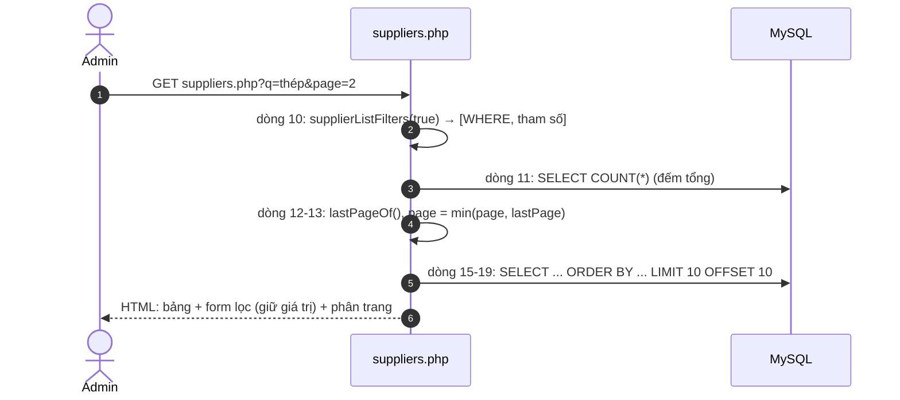

# 03. DANH SÁCH NHÀ CUNG CẤP: TÌM KIẾM, LỌC, SẮP XẾP, PHÂN TRANG, XUẤT EXCEL

**File**: `suppliers.php` (danh sách), `supplier_export.php` (xuất Excel), `supplier_detail.php` (chi tiết)  
**Chỉ admin** (dòng `requireLogin();` ở đầu mỗi file).

---

## 1. Danh sách dùng GET, không dùng POST

Tìm kiếm/lọc/sắp xếp **không thay đổi dữ liệu**, nên dùng form `method="get"`: tham số hiện trên thanh địa chỉ, F5 an toàn, gửi link vẫn đúng kết quả.

```
suppliers.php?q=thép&category_id=1&status=active&has_debt=1&sort=name&dir=desc&page=2
```



| Dòng | Việc |
|---|---|
| 8 | `requireLogin()` |
| 10 | `[$whereSql, $params] = supplierListFilters(true);` – đọc `?q= &category_id= &status= &rating_min= &has_debt=` từ `$_GET`, trả về chuỗi `WHERE` và mảng tham số (`functions.php` dòng 686) |
| 11–13 | Đếm tổng, tính số trang cuối; trang vượt quá thì về trang cuối |
| 15–19 | Câu SELECT: `supplierSelectSql(true)` + `WHERE` + `supplierOrderSql(true)` + `LIMIT 10 OFFSET (trang-1)*10` |
| 48 | Form tìm kiếm: `method="get" action="<?php echo htmlspecialchars($_SERVER["PHP_SELF"]); ?>"` |
| 115 | Nút **Xóa** là form **POST** gửi tới `supplier_delete.php` (xem `05`) |
| 128 | `paginationHtml($page, $lastPage, $filters + $sortParams)` – nút trang giữ nguyên bộ lọc |

### Phần "lọc" an toàn
* `status` phải nằm trong `SUPPLIER_STATUSES` (`active/inactive/blacklisted`), lạ thì bỏ qua.
* `category_id`, `rating_min` qua `getInt()` → số nguyên.
* `q` thoát `! % _` rồi `LIKE :q1 ESCAPE '!'`.
* `has_debt=1` thêm `EXISTS (SELECT 1 FROM supply_transactions ... remaining_amount > 0)`.
* `sort` chỉ nhận khóa trong `SUPPLIER_SORTS` (tên cột SQL do **code** quyết định, không lấy từ người dùng).

### Phân trang
`PER_PAGE = 10` (`config.php`). `paginationHtml()` luôn hiện trang đầu, trang cuối và 2 trang quanh trang hiện tại, chỗ bỏ qua là "…".

---

## 2. `supplier_export.php` – xuất Excel

Cùng bộ lọc và cách sắp xếp với danh sách nhưng lấy toàn bộ kết quả (tối đa 5000 dòng, `LIMIT 5000`). Nút "Xuất Excel" trong `suppliers.php` là một liên kết GET mang theo đúng bộ lọc hiện tại: `supplier_export.php?q=...&sort=...`.

`xlsx_build()` (file `xlsx.php`) tự ghép file `.xlsx` (thực chất là file zip chứa vài file XML) bằng PHP thuần; trình duyệt nhận header `Content-Disposition: attachment` nên tải file về, trang đang xem không đổi.

---

## 3. `supplier_detail.php?id=N` – chi tiết cho admin

Không tìm thấy → `suppliers.php?msg=not_found`. Dùng `loadSupplierDetail($id, true)` và `supplierDetailHtml($detail, true)`: đủ mã số thuế, hạn mức, công nợ, **tất cả** liên hệ (có nút Thêm/Sửa/Xóa/Đặt làm chính, xem `06`) và danh sách đánh giá.
