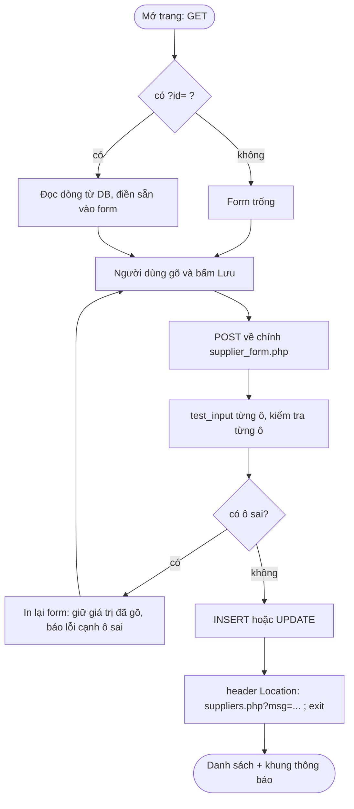

# 04. THÊM VÀ SỬA NHÀ CUNG CẤP (`supplier_form.php`)

**Một file cho cả hai việc** (đây là phần nên trình bày kỹ nhất khi bảo vệ):

| Địa chỉ | Chế độ | `$id` |
|---|---|---|
| `supplier_form.php` | Thêm | `0` |
| `supplier_form.php?id=5` | Sửa NCC số 5 | `5` |

Có kèm upload logo nên thẻ form có `enctype="multipart/form-data"`.

---

## 1. LUỒNG TỔNG QUÁT



---

## 2. ĐI THEO TỪNG DÒNG CỦA `supplier_form.php`

### Bước 1 – khai báo biến (dòng 14–29)
```php
$id = toInt($_POST["id"] ?? $_GET["id"] ?? "");   // có id = sửa
$code = $name = $categoryId = $tax = $email = $phone = $address = "";
$credit = "0";   $status = "active";
$codeErr = $nameErr = $categoryErr = ... = "";     // chưa có lỗi nào
```
Nếu `$id > 0` thì đọc dòng cũ (`$existing`); không có dòng đó → `suppliers.php?msg=not_found`.

### Bước 2 – khi POST, lấy và kiểm tra (dòng 31–94)
```php
if ($_SERVER["REQUEST_METHOD"] == "POST") {
    $code = test_input($_POST["supplier_code"] ?? "");
    ...
    if ($code == "")                      $codeErr = "Vui lòng nhập mã nhà cung cấp";
    elseif (!valid_supplier_code($code))  $codeErr = "Mã gồm 3–20 ký tự: ...";
    elseif (getValue("SELECT supplier_id FROM suppliers WHERE supplier_code = :code AND supplier_id <> :id", ...) !== null)
                                          $codeErr = "Mã nhà cung cấp đã tồn tại";
```
Mỗi ô một đoạn `if / elseif`, **sai ở đâu ghi lỗi vào biến `$xxxErr` của ô đó**:

| Ô | Dòng | Quy tắc |
|---|---|---|
| Mã | 43–49 | bắt buộc; `valid_supplier_code` (3–20 ký tự hoa/số/`-`/`_`); **không trùng** với NCC khác (`supplier_id <> :id` để sửa chính mình không bị coi là trùng) |
| Tên | 51–55 | bắt buộc; ≤ 150 ký tự |
| Danh mục | 57–61 | phải chọn; phải tồn tại trong `supplier_categories` |
| Mã số thuế | 63–69 | không bắt buộc; `valid_tax_code` (10 số, hoặc 10 số + `-XXX`); không trùng |
| Email | 71–73 | không bắt buộc; `filter_var(..., FILTER_VALIDATE_EMAIL)` |
| Điện thoại | 75–77 | không bắt buộc; `valid_phone` |
| Địa chỉ | 79–81 | ≤ 255 ký tự |
| Hạn mức | 83–87 | `valid_money`: số ≥ 0, tối đa 2 chữ số thập phân |
| Trạng thái | 89–91 | nằm trong `SUPPLIER_STATUSES` |
| Logo | 93–94 | `read_optional_upload("logo", 2MB, jpg/png/webp)`: **chỉ kiểm tra**, chưa lưu file |

### Bước 3 – không lỗi thì ghi (dòng 96–153)
```php
if ($codeErr == "" && $nameErr == "" && ... && $logoErr == "") {
```
* **Logo** (dòng 100–111): có chọn file mới → `save_upload()` lưu vào `uploads/logos/` với **tên ngẫu nhiên**; tick "Xóa logo hiện tại" → `NULL`; không làm gì → giữ logo cũ. Kiểm tra lỗi ở mọi ô **trước**, lưu file **sau**, nên nhập sai không để lại file thừa.
* Ô rỗng tùy chọn đổi thành `NULL` bằng `nullIfEmpty()` (mã số thuế rỗng mà để `""` sẽ vi phạm UNIQUE khi có hai NCC cùng bỏ trống).
* **Sửa** (dòng 120–130): `UPDATE suppliers SET ... WHERE supplier_id = :id`; xong xóa file logo cũ nếu đã bị thay/gỡ; `header("Location: suppliers.php?msg=supplier_updated")`.
* **Thêm** (dòng 131–137): `INSERT INTO suppliers (...) VALUES (...)`; `header("Location: suppliers.php?msg=supplier_added")`.
* Dòng 139: `exit;` – bắt buộc sau `header("Location")` để PHP dừng, không chạy tiếp xuống phần in form.
* **Bắt lỗi trùng khóa** (dòng 140–151): nếu hai người cùng lưu một mã trong cùng một giây, kiểm tra ở dòng 43–49 chưa kịp chặn thì cột `UNIQUE` của MySQL chặn (mã lỗi 1062) → `catch` báo lại đúng ô; đồng thời xóa file logo vừa lưu (không để file mồ côi).

### Điền sẵn khi mở form sửa (dòng 154–165)
```php
} elseif ($id > 0) {          // GET và có id: lấy từ database
    $code = $existing["supplier_code"]; ...
}
```
Nhánh `elseif` này chỉ chạy khi **không** phải POST. Khi POST có lỗi, các biến giữ **giá trị người dùng vừa gõ** (đã gán ở bước 2) nên không bị ghi đè bằng dữ liệu cũ.

### Bước 4 – in form (dòng 167 → cuối)
```php
<form method="post" action="<?php echo htmlspecialchars($_SERVER["PHP_SELF"]); ?>" enctype="multipart/form-data" novalidate>
    <input type="hidden" name="id" value="<?php echo $id; ?>">
    <input class="form-control<?php echo invalid($codeErr); ?>" name="supplier_code" value="<?php echo h($code); ?>">
    <div class="invalid-feedback"><?php echo h($codeErr); ?></div>
```
* `value="<?php echo h($code); ?>"` → giữ lại điều đã gõ (`h()` thoát ký tự đặc biệt).
* `invalid($codeErr)` → có lỗi thì thêm class `is-invalid` (viền đỏ); `invalid-feedback` là chỗ hiện câu báo lỗi.
* `novalidate` tắt kiểm tra của trình duyệt để **PHP là nơi kiểm tra duy nhất** và câu báo lỗi nhất quán.

---

## 3. CÁC FILE THEO ĐÚNG MẪU NÀY

`category_form.php`, `user_form.php`, `contact_form.php`, `transaction_form.php`, `evaluation_form.php` có cùng bốn bước; khác nhau ở danh sách ô và quy tắc. Xem `06`, `07`, `08`.
