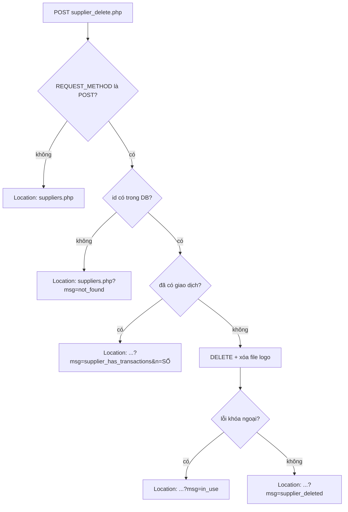

# 05. XÓA NHÀ CUNG CẤP (`supplier_delete.php`)

**Không có giao diện**: chỉ xử lý POST rồi chuyển trang. Cùng khuôn với `category_delete.php`, `user_delete.php`, `transaction_delete.php`, `evaluation_delete.php`, `contact_delete.php`.

---

## 1. Vì sao xóa phải là POST?

Nếu xóa bằng liên kết `<a href="supplier_delete.php?id=5">` thì chỉ cần ai đó gửi link, hoặc trình duyệt tự tải trước liên kết, là dữ liệu mất. Vì vậy mỗi dòng trong `suppliers.php` có **một form nhỏ**:

```php
<form class="d-inline" method="post" action="supplier_delete.php"
      onsubmit="return confirm('Xóa «...»? ...');">
    <input type="hidden" name="id" value="5">
    <button type="submit" class="btn btn-sm btn-outline-danger">Xóa</button>
</form>
```
* `onsubmit="return confirm(...)"`: hộp "Bạn chắc chắn?" của trình duyệt; bấm Hủy thì form **không gửi**.
* Ai gõ thẳng `supplier_delete.php?id=5` trên thanh địa chỉ là **GET** → dòng 7–10 chuyển về danh sách, không xóa gì.

---

## 2. CÁC DÒNG CỦA `supplier_delete.php`



| Dòng | Việc |
|---|---|
| 7–10 | Không phải POST → về danh sách |
| 12–17 | `toInt($_POST["id"])`; đọc dòng; không có → `not_found` |
| 19–23 | **Đã có giao dịch thì không xóa** để giữ sổ sách (khuyên chuyển sang "ngừng hoạt động"); báo số giao dịch qua `?n=` |
| 25–27 | `DELETE FROM suppliers WHERE supplier_id = :id`; xóa file logo; người liên hệ và đánh giá xóa theo (khóa ngoại `ON DELETE CASCADE`) |
| 28–34 | Nếu ngay lúc đó có giao dịch phát sinh, MySQL chặn bằng khóa ngoại → `catch` → `?msg=in_use` (không lỗi trắng màn hình) |
| 35 | `?msg=supplier_deleted` |
